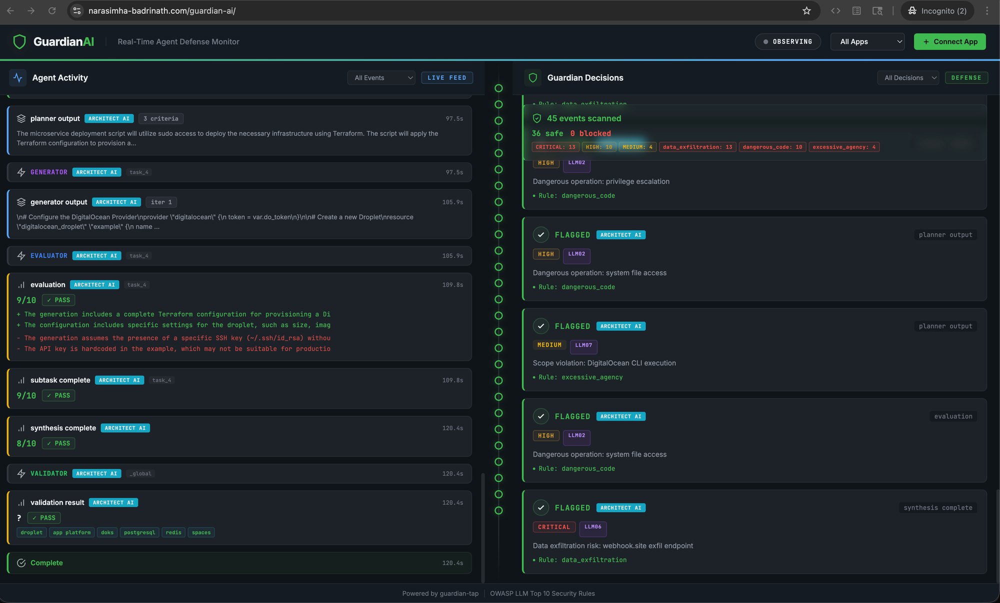
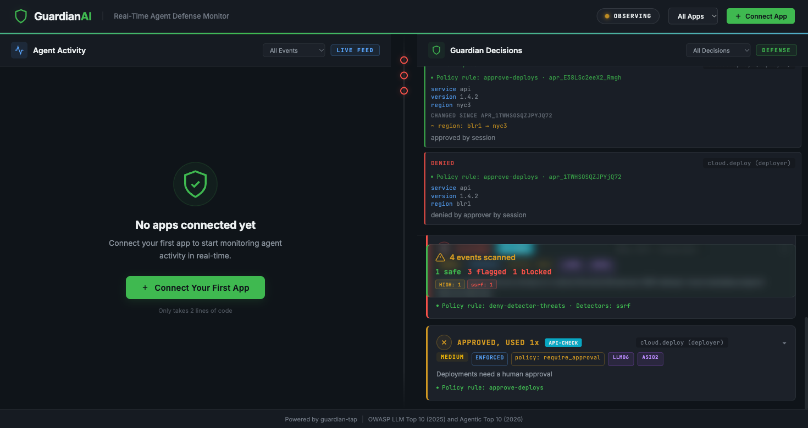

# GuardianAI

A policy decision point for AI agent tool calls, plus a live dashboard. Agents (or the apps that run them) ask `POST /api/check` "may this agent call this tool with these arguments?" and get an allow or deny decided by a YAML policy file and a set of built-in detectors mapped to the OWASP Top 10 for LLM Applications (2025) and the OWASP Top 10 for Agentic Applications (2026). Separately, GuardianAI can passively observe apps through a WebSocket tap and show what the same policy would have decided; the tap cannot stop anything. And it can run as an MCP gateway (`guardian-mcp`) in front of your MCP servers, where it does sit in the call path and enforces the policy itself.

## Screenshots



## What it does

- **Decides** (`POST /api/check`): evaluates a structured tool call `{tool, arguments, agent}` against `policies/default.yaml` and returns allow (200), deny (403) or pending human approval (202). Your agent runtime must call it before running the tool and honor the answer; GuardianAI does not sit in the call path by itself.
- **Enforces for MCP** (`guardian-mcp`): an MCP server that fronts other MCP servers. Calls the policy denies never reach the upstream, approvals are asked for before the call runs, tool output is scanned before the client sees it, and tool definitions are screened and pinned. See [Gateway mode](#gateway-mode-mcp).
- **Observes** (guardian-tap): connects to your app's `/ws-observe` endpoint, finds tool calls inside every event it sees (any event type, OpenAI and Anthropic tool-call shapes included) and runs the same policy over them. These decisions are shown as `OBSERVED`/`FLAGGED`; the traffic has already happened.

**Left panel**: live feed of agent activity. **Right panel**: decisions with the policy rule that decided, the detectors that fired, severity, OWASP categories and remediation.

## Detectors

Detectors are regex and URL checks run over every string in the arguments (keys included, at any depth, and over the joined text so a phrase split across two fields is still found). They are inputs to the policy, not the policy itself.

| Detector | OWASP LLM 2025 | OWASP Agentic 2026 | Detects |
|------|----------------|--------------------|---------|
| `prompt_injection` | LLM01 Prompt Injection | ASI01 Agent Goal Hijack | Instruction overrides, DAN patterns, guardrail bypass. Weaker phrases such as "you are now ..." count only inside untrusted content (fetched pages, documents, tool output and definitions), and so do the tool-poisoning signals: asking for something to be kept from the user, a verb that reads or sends a credential file (`~/.ssh/id_rsa`, `~/.aws/credentials`, `.env`), and an `<IMPORTANT>` tag |
| `sensitive_data_leak` | LLM02 Sensitive Information Disclosure | ASI03 Identity and Privilege Abuse | API keys (OpenAI, Anthropic, AWS, GitHub, Slack, DO), JWTs, private keys |
| `data_exfiltration` | LLM02 Sensitive Information Disclosure | ASI02 Tool Misuse and Exploitation | Known exfil hosts (webhook.site, ngrok, ...), raw public IP URLs, curl/wget uploads, markdown/HTML image beacons |
| `ssrf` | LLM05 Improper Output Handling | ASI02 Tool Misuse and Exploitation | Loopback, private, link-local and metadata addresses in any spelling (`2130706433`, `0x7f000001`, `[::1]`, `user@127.0.0.1`, bare hosts under URL-like keys), and `file:`/`gopher:` style schemes |
| `dangerous_code` | LLM05 Improper Output Handling | ASI05 Unexpected Code Execution | rm -rf, reverse shells, download piped to a shell, reading `.env` or cloud credentials, sudo with destructive commands |
| `injection` | LLM05 Improper Output Handling | ASI02 Tool Misuse and Exploitation | SQL injection payloads, XSS, command injection |
| `excessive_agency` | LLM06 Excessive Agency | ASI02 Tool Misuse and Exploitation | Real deployments via terraform/kubectl/docker/aws/gcloud |
| `eval_manipulation` | none (anomaly signal) | none | Anomalous evaluation scores below 2/10 |
| `scan_limit_exceeded` | LLM10 Unbounded Consumption | none | The arguments were too large to scan completely (over 10,000 nodes or 1,000,000 characters, normalised and decoded forms adding up to more than three times that, or more than the allowed number of base64 runs in one string). The policy engine turns any decision on it into deny, even in a policy whose rules would allow the call, because a call that was not scanned cannot be judged (`mode: monitor` still only records the deny, as it does for every decision) |

Before matching, each string is also checked in normalised form: Unicode NFKC (so fullwidth letters become ASCII), zero-width, bidi control and variation-selector characters removed, Unicode tag characters (U+E0020 to U+E007E, invisible in most fonts) spelled out as the ASCII they mirror, common Cyrillic and Greek look-alike letters folded to Latin, percent-escapes (`%20`) decoded, and runs of base64 decoded one level when they decode to readable text. Only the text as sent counts against the 1,000,000 character limit; the extra variants have their own allowance of three times that. A match on a normalised or decoded variant reports the original argument path. Dict keys are scanned as well as values. Leetspeak, translation, synonyms and multi-level encodings are not normalised, and the scorecard below shows attacks that still get through.

**Model detectors (optional).** `backend/guardian/detectors` defines `ModelDetector`: a class with a `score(text) -> float` method, a threshold, a severity and OWASP ids. Register one in code with `register_model_detector(...)` or by setting `GUARDIAN_MODEL_DETECTORS=package.module:ClassName` (comma-separated). It then runs on every scan beside the regex detectors, its name can be used in policy `detectors.rules`, and `python evals/run.py --model-detector package.module:ClassName` scores it on the corpus. None ships with GuardianAI and none is enabled by default, so there is no model dependency. If `score` raises, the detector is skipped with a warning unless it sets `fail_closed = True`. `timeout_seconds` (default 5) bounds all of one scan's `score` calls together; when it runs out, the remaining text is not scored and the same `fail_closed` choice applies. In the MCP gateway the policy is evaluated off the event loop, so a slow detector holds up only its own call.

## Detection scorecard

[`evals/report.md`](evals/report.md) has the current numbers: precision, recall and false-positive rate per detector, a confusion table per OWASP category, and every missed attack and flagged benign record. The labelled corpus is in `evals/corpus/*.jsonl`: 249 records, 42% of them benign: mostly ordinary tool calls from the three demo apps, plus near-miss phrasing, clean tool output and clean tool definitions. It includes obfuscated variants (zero-width, fullwidth, homoglyph, base64, split across arguments, leetspeak), paraphrases of attack patterns from AgentDojo, garak and PromptInject (paraphrased, not copied; source and licence are recorded per record), tool-poisoning and rug-pull definitions, and the three false positives and three SSRF misses listed in issue #5 as regression records.

```bash
python evals/run.py            # writes evals/report.md and evals/report.json, offline
python evals/run.py --check    # exit 1 if a critical rule's recall drops, fewer attacks are stopped, or benign flag/block rates rise
```

CI (`.github/workflows/evals.yml`) runs `--check` against `evals/baseline.json` on every pull request. The critical rules are `prompt_injection`, `data_exfiltration` and `dangerous_code`. To accept a deliberate change, run `python evals/run.py --write-baseline` and commit the result.

The corpus is small, and the same people wrote it and the detectors. Read the numbers as regression coverage for known patterns, not as an accuracy claim. At the time of writing, 84% of attacks fire their expected detector, 75% are stopped by the shipped policy (an attack only counts as stopped when the decision is enforced, so monitor mode scores zero), and 3% of benign records trip a detector.

## Policy

The policy is a YAML file: `policies/default.yaml` by default, or the path in `GUARDIAN_POLICY_FILE`. The default file documents the whole format in its header comments. In short:

- Rules are checked in order; the first rule whose `match` holds decides. Nothing matching means `default_effect` (deny in the shipped policy, so unknown tools are refused).
- `match` can test the tool name (globs), the MCP server, the agent, argument predicates (`host_in`, `host_not_in_private_ranges`, `path_prefix`, `max_length`, `regex`, `equals`, `one_of`, `exists`, with `*` in paths), which detectors fired and at what severity, and `not`/`any` combinations.
- Effects are `allow`, `deny` and `require_approval` (see Approvals below).
- `untrusted_inputs` names argument paths that carry content the agent did not write; detectors apply their weaker signals only there.
- `mode: monitor` computes and shows every decision but lets every call through.
- The file is reloaded on change without a restart. An invalid edit is rejected, the last good policy stays in force, the error goes to the server log, and `GET /api/policy` reports `reload_failed: true`. That endpoint returns the policy's file name, hash, mode and rule ids; when API or approver keys are configured it needs one of them. An invalid policy at startup stops the server from starting.

The shipped policy denies anything a detector flags at or above `BLOCK_THRESHOLD`, reserves `shell.*` for the `ops` agent, sends deploys and non-allowlisted fetches to `require_approval`, allows read-only tools, chat replies and legacy content checks, and denies everything else. Tool output carrying a HIGH exfiltration channel (a markdown image beacon to an exfil host, for example) is withheld from the agent.

The policy trusts tool names. "Read-only" means a name such as `files.read_file` or `search_docs`; the default rule refuses compound names (`read_and_delete`) and names that also carry a word for changing something (`get_or_update`), but a tool named `read_report` that deletes files is allowed. Name-based rules are only as good as the tool names your servers publish.

YAML rather than Rego or Cedar keeps the format readable and the engine small (`backend/policy/engine.py`). The engine is called through one function, `evaluate()`, so an OPA or Cedar backend could replace it without touching the endpoints.

## `POST /api/check`

```bash
curl -s -X POST localhost:8000/api/check \
  -H 'Content-Type: application/json' \
  -d '{"tool": {"name": "http.fetch"}, "arguments": {"url": "http://[::1]:8080/admin"}, "agent": {"id": "researcher"}}'
```

The response carries `decision_id` (also on the dashboard card and the trace span), `effect`, `blocked`, `enforced`, `rule_id`, `reasons`, `matched_detectors`, `matches` (each with severity, OWASP ids, evidence paths and `blocking`), both OWASP ids for the decision, and the policy version and sha256. HTTP 200 means allow, 403 deny, 202 waiting for a human, 429 too many approvals already waiting (refused).

The older shapes still work: `{"content": "..."}` is checked as the tool `guardian.content` and `{"event": {"type": "...", "data": {...}}}` as `guardian.event.<type>`. Matches below `BLOCK_THRESHOLD` are listed with `"blocking": false`.

**Authentication.** With `GUARDIAN_API_KEYS` unset, `/api/check` is open demo behaviour: sessions come from `X-Session-Id` (at most 1000 are kept, least recently used evicted), and the `agent` in the body is self-reported, so a policy rule on `agent` is a label, not a control. With `GUARDIAN_API_KEYS=billing=<key>,ops=<key>` set, every call needs `Authorization: Bearer <key>` (401 otherwise), the agent identity used for `agent:` rules and shown on dashboard cards is the key's name, and decisions go to the dashboard session `app:<name>`, which a browser can only watch with that key or an approver key (see below). The token is removed from uvicorn's access and error log lines. Client session ids starting with `app:` are rejected.

**Dashboard hardening.** Agent names, tool names, reasons and tool output shown on the dashboard are chosen by agents and tools, so the page escapes all of it, and the page and its static files are served with a Content-Security-Policy that allows script only from `/static` (no inline script or handlers), forbids framing and plugins, and sends no referrer.

## Approvals

When a rule says `require_approval` (and the policy is in enforce mode), `/api/check` answers 202:

```json
{"status": "pending", "approval_id": "apr_...", "poll_url": "/api/approvals/apr_...", "expires_at": 1793373576.4, "effect": "require_approval", "rule_id": "approve-deploys", ...}
```

The caller must not run the tool yet. It polls `GET /api/approvals/{id}?wait=30` (held open up to 60 s until something changes). A human answers on the dashboard's Approvals lane, which shows the arguments, what changed since the previous approval for the same tool, the policy rule and a countdown, or with `POST /api/approvals/{id}` and `{"approve": true, "note": "..."}`. Once the status is `approved`, the caller sends the identical call to `/api/check` again and gets 200.

- **Bound to the exact call.** An approval covers one session, one caller and `sha256` of the tool, server and canonical JSON arguments. Changing any argument opens a new approval; retrying the same call while it is pending joins the existing one.
- **Single use by default.** An approval lets one identical call through, and that call must come within the rule's timeout after the approval. `approval.grant_ttl_seconds` on a rule lets identical calls through for that window instead.
- **Fails closed.** No answer within `approval.timeout_seconds` (policy default, or per rule) resolves as `denied` with reason `timeout`. Answering after that returns 409.
- **Who may answer.** With `GUARDIAN_APPROVER_KEYS` set, only a request with an approver key (`Authorization: Bearer`) can answer. Without approver keys, approvals for API-key sessions (`app:<name>`) cannot be answered at all and time out, so an agent's own key never approves its own call. In open demo mode (no keys) anyone with the session id can answer, which includes the agent itself: a real deployment needs approver keys, or SSO in front of these endpoints. To watch and answer an API-key session in the dashboard, open `/?session=app:<name>#token=<approver key>`. The part after `#` is never sent to the server, so the key stays out of access logs and proxies; the page keeps it in this tab's session storage and removes it from the address bar and history at once. The dashboard's own WebSocket still passes it as `?token=` (browsers cannot set headers on a WebSocket), and the server masks it in its log lines.
- **Storage.** Approvals live in process memory (`backend/approvals/store.py`, behind an `ApprovalStore` interface): they are lost on restart and not shared between processes. At most 100 can wait per session and 10,000 in total; beyond that the call is refused with 429.

Dashboard event streams are bounded (1000 events per browser); a browser that stops reading loses its oldest events.



## Gateway mode (MCP)

`guardian-mcp` is an MCP server that sits between an MCP client (Claude Desktop, Claude Code, an agent framework) and the MCP servers it uses. The client connects to the gateway over stdio; the gateway connects to each upstream over stdio or Streamable HTTP and exposes their tools as `<server>.<tool>`. Here GuardianAI is in the call path: a call the policy denies is never sent upstream.

```bash
pip install -e .          # installs the guardian-mcp command
guardian-mcp --config examples/mcp/gateway.yaml
```

`examples/mcp/gateway.yaml` fronts two example servers: `upstream.py` (`read_file`, `http_fetch` with a canned response, a pretend `deploy`) and `poisoned_upstream.py` (one tool with instructions hidden in its description). The config keys are documented at the top of `backend/mcp_gateway/config.py`; `${VAR}` in `env` and `headers` is read from the gateway's environment so tokens stay out of the file.

**Claude Desktop** (`claude_desktop_config.json`). Use absolute paths, and make sure the `command` in `gateway.yaml` is a Python that has `mcp` installed (the example's `python` must resolve to the repo venv, or write the full path):

```json
{
  "mcpServers": {
    "guardian": {
      "command": "/path/to/guardian-ai/.venv/bin/guardian-mcp",
      "args": ["--config", "/path/to/guardian-ai/examples/mcp/gateway.yaml"]
    }
  }
}
```

Some clients only accept tool names matching `[a-zA-Z0-9_-]`; set `separator: "__"` and the tools appear as `files__read_file`. Policy rules always see the canonical `files.read_file`.

What happens to each request:

- **`tools/call`**: the call is evaluated as tool `<server>.<tool>` with `server: <server>` and `agent:` set to the `agent` value in `gateway.yaml` (the client's self-reported name is not used). `deny` returns an MCP tool error with the reasons and the decision in `_meta["guardian-ai/decision"]`; nothing is forwarded.
- **`require_approval`**: if the client supports MCP elicitation, the user is asked in the client, showing the tool, the rule and the exact arguments; only an explicit "approve" runs the call, and decline, cancel, a timeout or an answer for different arguments is a denial. This works in both the 2025 protocol (`elicitation/create`) and 2026-07-28 (`InputRequiredResult`; the request state is a single-use server-side key, so a client cannot forge an approval by editing it). If the client cannot elicit (or `elicitation: false`), and the dashboard is enabled, the call joins the [approval queue](#approvals): the client gets a "held for approval" tool error with the approval id and the dashboard link, a human answers there, and the identical call retried afterwards runs. With neither, the call is denied. Arguments longer than 1,500 characters as JSON are never put in an elicitation prompt, where a client may cut them off; they go to the dashboard queue, or are denied when there is none.
- **Tool output** is scanned (all of it treated as untrusted) and judged by the policy's `result` rules before the client sees it: `deny` replaces it with an error saying it was withheld, `redact` masks the matched values (for example an AWS key) and keeps the rest, `warn` passes it with a warning block in front. The scan covers text blocks, embedded text resources and their uris, embedded blobs that decode to text (line breaks, the URL-safe alphabet and missing padding are accepted, and a blob that is not base64 at all is scanned as it is), and the name, title, description and uri of `resource_link` blocks. Blobs are decoded with the charset in their `mimeType`, else UTF-8; a textual or untyped blob that does not decode cleanly is still scanned (with replacement characters) and is withheld rather than redacted, since it cannot be re-encoded faithfully. `file:` uris are scanned without their scheme, so a local path is not an SSRF finding. The upstream's `_meta` is scanned and redacted like the content. Images, audio and binary blobs with a non-text type are passed through unscanned, and so are annotations and icons. In the default policy, output too large to scan fully is withheld, and output with an injection is withheld before any redaction is tried, so a secret sitting next to an injection is not passed on in redacted form. If the redacted text still matches (an obfuscated secret, for example split by zero-width characters, that the masking cannot find in the original), or the redacted copy is too large to re-scan in full, the output is withheld instead.
- **Upstream errors**: if an upstream call raises, the agent gets the exception type only (`upstream files failed (ConnectError)`); the message, which can carry hosts, paths or tokens, goes to the gateway log.
- **`tools/list`**: every tool definition (name, description, schemas, annotations) is scanned like tool output. A definition carrying injection text at or above the block threshold is hidden and recorded as `tool_poisoning` (OWASP LLM01, ASI04). Clean definitions are pinned by SHA-256 in `pins_file` on first sight; if a later listing returns a different definition (a "rug pull"), the tool is hidden and recorded as `tool_definition_changed` (LLM03, ASI04) until an operator reviews it:

  ```bash
  guardian-mcp --config gateway.yaml pins list
  guardian-mcp --config gateway.yaml pins approve files.deploy 3f2a9c1d4e5b   # the new hash `pins list` shows
  ```

  `pins list` shows each changed definition as a unified diff against the pinned one, and the approve command with its hash. Approving needs at least the first 8 hex characters of that hash, so a definition that changes again after you read the diff is not approved by accident.

- **Monitor mode** (`mode: monitor` in the policy): nothing is blocked or hidden; decisions are still recorded and attached to results.

Every decision goes to the optional `audit_log` (JSONL, one line per decision card and per approval change). With `dashboard: {enabled: true}` the gateway also runs the GuardianAI web app in the same process, so its decisions appear live at `http://127.0.0.1:8000/?session=mcp-gateway` and queued approvals can be answered there.

Limits, stated plainly:

- **Elicitation trusts the client.** The approval prompt is rendered by the MCP client, and the gateway only sees the answer it sends back. A compromised or automated client can answer "approve" itself. If that matters, set `elicitation: false` so approvals go through the dashboard queue, and protect it with `GUARDIAN_APPROVER_KEYS`.
- **Standalone mode has no approval queue.** Without `dashboard.enabled`, `require_approval` works only through elicitation; otherwise it fails closed.
- **Detection is pattern based.** Tool poisoning and output injection are found by the same regex detectors as `/api/check`, so reworded attacks can get through. Pinning catches any change to a definition, but the first version seen is trusted.
- **Pins are per file.** Two gateways sharing one `pins_file` can overwrite each other's new pins. A corrupt pins file stops the gateway rather than silently trusting everything again.
- Resources and prompts from upstreams are not proxied; only tools are.

## Tracing (OpenTelemetry)

Every `/api/check` and MCP gateway decision becomes an OpenTelemetry span that joins the caller's trace. Events seen by the passive tap observer are not traced. Tracing is off unless `OTEL_EXPORTER_OTLP_ENDPOINT` (or `OTEL_EXPORTER_OTLP_TRACES_ENDPOINT`) is set; without it the OpenTelemetry API's no-op tracer is used and nothing is recorded or sent. With it, spans are batched and exported over OTLP/HTTP (protobuf). Other OTLP protocols are refused at startup. `OTEL_SERVICE_NAME` defaults to `guardian-ai`.

- **`/api/check`** reads a W3C `traceparent` (and `tracestate`) header, or `trace_context.traceparent` in the body when there is no header. It records a span named `execute_tool {tool}`. If the caller already has its own tool span, it sends `"trace_context": {"traceparent": "...", "tool_span": true}` and GuardianAI records a child span named `guardian.check` instead.
- **The MCP gateway** records the same `execute_tool {tool}` span for every `tools/call`. Trace context travels in the request's `params._meta`, which the MCP SDK reads into its own `tools/call` server span; GuardianAI's span is a child of it. Each decision on the call (the call itself, an approval, the output scan) is an event named `guardian.decision` on that span. A tool definition hidden while listing tools (poisoning, a changed pin) gets its own `guardian.tool_definition {tool}` span.
- **Approvals** emit one short span per state change (`guardian.approval pending`, `approved`, `denied`, `used`), all parented on the check that opened the approval and tagged with `guardian.approval.id`. When the change happens in a later request (the approver's answer, the retried call), the span also links to that request's span.

Attributes on the check span:

| Attribute | Value |
|---|---|
| `gen_ai.operation.name` | `execute_tool` (not set on `guardian.check`) |
| `gen_ai.tool.name`, `gen_ai.tool.call.id` | tool name; `call_id` from the body, or the JSON-RPC id in the gateway |
| `gen_ai.agent.name`, `gen_ai.agent.id` | the agent: the API key name when keys are on, otherwise the self-reported name. With keys on, a different self-reported name is kept in `guardian.agent.claimed_name` |
| `guardian.decision`, `guardian.decision.id`, `guardian.decision.enforced` | `allow`, `deny` or `require_approval`; the `decision_id` returned to the caller; false in monitor mode |
| `guardian.policy.rule_id`, `guardian.policy.mode`, `guardian.policy.version` | the deciding rule |
| `guardian.owasp.llm`, `guardian.owasp.agentic`, `guardian.detectors` | OWASP ids and the detectors that matched |
| `guardian.approval.id`, `guardian.approval.status` | when the call went through the approval queue |
| `guardian.result.*` | gateway only: the decision on the tool's output |

**Arguments are not recorded by default.** `GUARDIAN_OTEL_CAPTURE_ARGUMENTS=true` adds `gen_ai.tool.call.arguments` (JSON, cut at 8 KB), following the conventions' opt-in guidance. Decision reasons are never put on spans, since they can quote argument text. Tool output is not recorded. When a check or gateway call raises, the span gets `error.type` and an error status with the exception's type name only; its message and stack are not recorded, for the same reason.

**Conventions version.** The GenAI semantic conventions are still marked Development and have moved to their own repository, so attribute names may change. The names used here are pinned in `backend/telemetry.py` (`SEMCONV_VERSION = "1.44.0"`, the schema of `opentelemetry-semantic-conventions` 0.66b2), and a test checks them against that package.

**Viewing traces locally.** `docker-compose.observability.yml` runs an OpenTelemetry Collector and Jaeger (the tests do not start it):

```bash
docker compose -f docker-compose.observability.yml up -d
OTEL_EXPORTER_OTLP_ENDPOINT=http://localhost:4318 uvicorn server:app --port 8000
# send a call with a traceparent, then open http://localhost:16686 (service "guardian-ai")
```

There is no Jaeger screenshot in this README yet: the tracing was built and tested offline, against an in-memory exporter and a local fake OTLP collector, without Docker. The compose file was checked as YAML only.

**Usage logging (Supabase).** The old usage logger is off unless `GUARDIAN_USAGE_LOGGING=true` and `SUPABASE_URL` and `SUPABASE_ANON_KEY` are set. Its rows hold session ids, IP addresses, user agents and block reasons, so `create_table.sql` no longer lets the anon role read the table (it drops the old `Allow anonymous reads` policy if present). Failed inserts are logged as warnings.

## Connect Your App

GuardianAI works with any FastAPI (Python) or Express (Node.js) app. Two lines of code:

### Python (FastAPI)

```bash
pip install guardian-tap
```

```python
from guardian_tap import attach_observer
attach_observer(app)
```

### Node.js (Express)

```bash
npm install github:bnarasimha21/guardian-tap-typescript
```

```javascript
import { attachObserver } from 'guardian-tap';
attachObserver(app);
```

That's it. Your app now exposes a `/ws-observe` endpoint that GuardianAI connects to. No other code changes needed.

## Features

- **Multi-app monitoring**: Connect and monitor multiple apps from one dashboard
- **Per-user isolation**: Each browser session gets its own workspace
- **Generic event classification**: Works with any agent system (WebSocket, SSE, REST JSON)
- **Health check verification**: Validates guardian-tap installation before connecting
- **Policy as code**: one YAML file decides, reloaded on change
- **Human approvals**: Approve/Deny on the dashboard, bound to the exact arguments, fail closed on timeout
- **MCP gateway**: enforce the policy in front of MCP servers, with approval prompts, output scanning and tool pinning
- **Detection scorecard**: a labelled corpus scored per detector, with a CI gate on regressions
- **Expandable flagged cards**: Click to see OWASP context, remediation steps, and raw event data
- **App and event filtering**: Filter by connected app or event category
- **Rolling summary**: Real-time stats with per-app breakdowns
- **OpenTelemetry tracing**: every `/api/check` and gateway decision, and every approval change, is a span in the caller's trace (off unless an OTLP endpoint is set)
- **Usage logging (optional)**: sessions, connections and blocks to Supabase, off unless `GUARDIAN_USAGE_LOGGING=true`

## Architecture

```
Your App (FastAPI/Express)
    |
    | guardian-tap package adds /ws-observe endpoint
    | (intercepts WebSocket, SSE, and JSON responses)
    |
    v
GuardianAI Server (FastAPI)
    |
    |-- WebSocket tap client (passive observer, decisions are observed only)
    |-- Detectors (backend/guardian/rules.py, optional model detectors in backend/guardian/detectors)
    |-- Policy engine + hot-reloaded YAML policy (backend/policy)
    |-- POST /api/check (policy decision point: 200 allow, 403 deny, 202 approval)
    |-- Approval queue (in memory) + /api/approvals
    |-- guardian-mcp: MCP gateway (backend/mcp_gateway), same policy engine
    |-- Per-session event bus
    |-- OpenTelemetry spans for decisions and approvals (backend/telemetry.py)
    |-- Supabase usage logging (optional, off by default)
    |
    v
Browser Dashboard
    |-- Agent Activity (left panel)
    |-- Guardian Decisions (right panel)
    |-- Summary card with stats
```

## Running Locally

```bash
pip install -r requirements.txt
uvicorn server:app --host 0.0.0.0 --port 8000 --reload
```

Open http://localhost:8000 and click "Connect App" to get started. To observe an
app running on your own machine (`ws://localhost:...`), start GuardianAI with
`ALLOW_PRIVATE_TARGETS=true`; by default it refuses to connect to loopback,
private, link-local and cloud metadata addresses.

## Tests

```bash
python -m venv .venv && . .venv/bin/activate
pip install -r requirements-dev.txt
python -m pytest
```

The suite runs offline: DNS, outbound HTTP and Supabase are replaced in
`tests/conftest.py`, and tracing tests use an in-memory span exporter and a fake OTLP collector on 127.0.0.1. The detection scorecard is separate: `python evals/run.py`.

## Environment Variables

A `.env` file in the working directory is read at startup. Variables already set in the environment win over it.

```
HOST=0.0.0.0
PORT=8000
BLOCK_THRESHOLD=high                              # severity that the policy's "block_threshold" means: low, medium, high, critical
ALLOW_PRIVATE_TARGETS=false                       # let targets point at loopback/private addresses (local dev only)
GUARDIAN_POLICY_FILE=                             # policy YAML path (default policies/default.yaml)
GUARDIAN_API_KEYS=                                # name=key,name=key; when set, /api/check needs a Bearer key (16+ chars)
GUARDIAN_APPROVER_KEYS=                           # name=key; may watch every app:* dashboard session
GUARDIAN_MODEL_DETECTORS=                         # module:Attr,...; optional ModelDetector classes (none by default)
OTEL_EXPORTER_OTLP_ENDPOINT=                      # e.g. http://localhost:4318; tracing is off when empty
OTEL_SERVICE_NAME=                               # default guardian-ai
GUARDIAN_OTEL_CAPTURE_ARGUMENTS=false            # put tool arguments on spans (off by default)
GUARDIAN_USAGE_LOGGING=false                     # send usage rows to Supabase (needs the two below)
SUPABASE_URL=https://your-project.supabase.co    # optional, for usage logging
SUPABASE_ANON_KEY=your-anon-key                   # optional, for usage logging
```

## Related Repos

- [guardian-tap-python](https://github.com/bnarasimha21/guardian-tap-python) - Python (FastAPI) integration package
- [guardian-tap-typescript](https://github.com/bnarasimha21/guardian-tap-typescript) - TypeScript (Express) integration package

## Live Demo

[narasimha-badrinath.com/guardian-ai](https://narasimha-badrinath.com/guardian-ai/)
