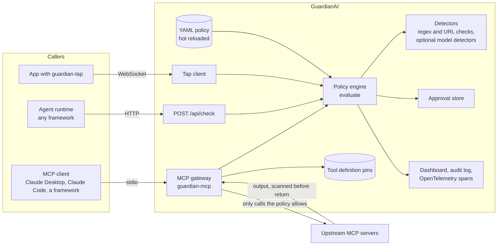

# GuardianAI design record

Written 2026-11-16 against commit `8870459`. This is the reasoning behind the design: what the
system has to do, the choices made and what each one costs, the numbers measured so far, and what
would have to change to run it for many teams. The README says how to use it. This says why it is
built this way.

GuardianAI is a working reference, not a production deployment. Section 7 lists what stands between
the two.

## 1. The problem

An agent turns model output into actions: it reads files, fetches URLs, runs shell commands and
deploys. The model can be steered by text it reads (a web page, a document, a tool description), so
the model itself cannot be the place where "may this action happen?" is decided. That decision needs
to sit outside the model, be written down as policy, and leave a record.

GuardianAI is that decision point for tool calls. It answers one question, "may this agent call this
tool with these arguments?", and a second one for tool output: "may the agent see this result?"

## 2. Requirements

What it has to do:

| # | Requirement | Where it is met |
|---|-------------|-----------------|
| R1 | Decide allow, deny or "ask a human" for each tool call, from a policy a person can read and review | `backend/policy`, `policies/default.yaml` |
| R2 | Stop a denied call before it reaches the tool, not report it afterwards | MCP gateway, `backend/mcp_gateway/proxy.py` |
| R3 | Judge tool output before the agent sees it: withhold, redact or warn | result-phase rules, MCP gateway |
| R4 | A human approval covers one exact call and cannot be reused for a different one | `backend/approvals/store.py` |
| R5 | Notice when a tool's definition carries instructions, or changes after it was first seen | `backend/mcp_gateway/pins.py` |
| R6 | Leave a record of every decision that joins the caller's trace | `backend/telemetry.py`, gateway `audit_log` |
| R7 | Work with agents that do not use MCP | `POST /api/check` |

How it has to behave:

| # | Requirement | Design response |
|---|-------------|-----------------|
| N1 | When in doubt, refuse | Default effect is deny. Every failure path in section 4 (D5) fails closed |
| N2 | The same call gets the same decision every time | Detectors are regex and URL checks. No model is in the decision path by default |
| N3 | The decision adds little delay to a tool call | Measured in section 5 |
| N4 | The policy changes without a restart, and a bad edit cannot take the system down | Hot reload that keeps the last good policy |
| N5 | The guard must not become a leak | Arguments are kept off trace spans by default. Upstream error messages stay in the gateway log |
| N6 | An agent cannot approve its own call | Approver keys are separate from agent keys |

## 3. Architecture

One policy engine, three ways to attach it. They differ in one thing that matters: whether
GuardianAI is in the path of the call.

| Mode | In the call path? | What a deny means | Use it when |
|------|-------------------|-------------------|-------------|
| MCP gateway | Yes | The call is never sent upstream | The agent's tools are MCP servers |
| `POST /api/check` | No. The caller asks and must obey | Nothing, unless the caller honors it | The agent runtime is yours and can be changed |
| Tap | No. The traffic already happened | Nothing. It is shown as observed or flagged | You want to see what a policy would do before enforcing it |

The three modes share the detectors, the policy file and the engine, so a policy tried out on the tap
behaves the same way once it is enforced at the gateway.

## 4. Decisions

Each decision lists the choice, the option not taken, the reason, and the cost.

### D1. Three attachment modes with different strength, labelled honestly

- **Choice.** Gateway enforces, `/api/check` advises, the tap observes. The dashboard marks tap
  decisions as `OBSERVED` or `FLAGGED`, never as blocked.
- **Not taken.** A single enforcing proxy for all traffic.
- **Why.** A proxy only covers traffic that goes through it. Agents with tools written in process have
  no hop to intercept, so they need an API they call themselves. Teams also want to watch before they
  block, which is what the tap and `mode: monitor` are for.
- **Cost.** Two of the three modes do not enforce anything by themselves. An agent pointed straight
  at the upstream servers bypasses the gateway. Closing that needs network policy outside this
  repository (section 7).

### D2. Default deny, first matching rule decides

- **Choice.** Rules are checked in order and the first match decides. No match means deny.
- **Not taken.** Default allow with a deny list. Or "most specific rule wins".
- **Why.** A new tool nobody has thought about should be refused, not waved through. First match is
  the simplest ordering to reason about when reading a policy top to bottom, and it makes "deny
  before redact" in result rules a matter of rule order.
- **Cost.** Noisy at the start: each tool a deployment uses needs a rule. Order matters, so a broad
  allow placed too early hides the rules below it.

### D3. YAML policy with a small engine, behind one function

- **Choice.** A YAML file and about 430 lines of engine. Everything calls `engine.evaluate()`.
- **Not taken.** OPA (Rego) or Cedar.
- **Why.** The people who need to review an agent policy are often not the people who can read Rego.
  The YAML format has the predicates agent calls need (host allowlists, private address ranges, path
  prefixes, detector severity) and nothing else. The single entry point means OPA or Cedar can
  replace the engine without changing the endpoints.
- **Cost.** No policy unit-test tooling, no formal analysis, no bundle distribution. Those are the
  reasons to move to OPA or Cedar at scale (section 8).

### D4. Deterministic detectors, with a slot for a model

- **Choice.** Detectors are regex and URL checks over normalised text (NFKC, invisible characters
  removed, look-alike letters folded, one level of percent and base64 decoding). A `ModelDetector`
  interface exists and none ships.
- **Not taken.** An LLM or classifier in the decision path by default.
- **Why.** N2 and N3. A regex decision is repeatable, explainable ("this pattern at this argument
  path") and takes a fraction of a millisecond. A model adds delay, cost, a dependency, and a second
  thing that can be prompt-injected.
- **Cost.** Reworded attacks get through. Prompt injection recall is 73.3% on the corpus and
  leetspeak and paraphrase are known misses. Detectors are one input to the policy for this reason:
  the allowlists, the approval rules and default deny do not depend on detection at all.

### D5. Fail closed on every path that can fail

| What fails | What happens |
|------------|--------------|
| Arguments or output too large to scan fully | Deny, even if a rule would allow |
| No approval answer in time | Denied, reason `timeout` |
| Policy edited into an invalid state | Rejected, last good policy stays, `reload_failed: true` is reported |
| Invalid policy at startup | Server does not start |
| Pins file corrupt | Gateway stops, it does not start trusting everything again |
| Approval needed, no elicitation and no dashboard | Denied |
| Redacted output still matches a detector | Withheld |
| Model detector raises or times out | Skipped with a warning, or deny if the detector sets `fail_closed` |

- **Not taken.** Fail open to keep agents running.
- **Why.** N1. A guard that lets calls through when it is confused is not a control.
- **Cost.** Availability. A broken pins file or a stuck approver stops work. The last row is the one
  place the default leans the other way, because a model detector is an optional extra signal.

### D6. Approvals are bound to the exact call

- **Choice.** An approval covers one session, one caller and the SHA-256 of tool, server and
  canonical JSON arguments. It is single use unless the rule sets a grant window. Lookup and create
  are one step, so identical calls arriving together open one approval and one of them gets through.
- **Not taken.** Approving a tool, or a tool for a time window, by default.
- **Why.** R4. The usual failure is a person approving `deploy to staging` and the agent then running
  `deploy to production` on the same approval. Hashing the arguments removes that.
- **Cost.** More prompts for the approver. The deny cooldown (30 seconds by default) keeps an agent
  retrying in a loop from paging them repeatedly. Large arguments are shown truncated, and when they
  are the dashboard offers only Deny.

### D7. Identity comes from the key, not from what the agent says

- **Choice.** With API keys set, the agent identity used by `agent:` rules is the key's name. The
  self-reported name is recorded as `guardian.agent.claimed_name` and not trusted. Approver keys are
  a separate set, and without them an API-key session cannot be approved at all.
- **Not taken.** Trusting `agent.id` in the request body.
- **Why.** N6. A policy rule such as "shell only for `ops`" is worthless if any caller can say it is
  `ops`.
- **Cost.** Static shared keys in an environment variable: no rotation, no expiry, no per-user
  identity. In open demo mode (no keys) the agent label is only a label, and the policy file says so.

### D8. Tool definitions are pinned on first sight

- **Choice.** The gateway scans each tool definition like untrusted output, hides ones carrying
  injection text, and pins clean ones by SHA-256. A later change hides the tool until an operator
  approves the full 64-character hash.
- **Not taken.** Trusting whatever `tools/list` returns each time. Or a signed registry of tools.
- **Why.** R5. Tool descriptions are read by the model, so a description is an injection channel, and
  an upstream can change a description after it has been reviewed.
- **Cost.** Trust on first use: the first definition seen is trusted if it scans clean. A signed
  registry would remove that and needs infrastructure this project does not have.

### D9. Output rules: withhold before redact

- **Choice.** Result rules run in order: unscannable, then injection, then exfiltration channel, then
  redact secrets, then warn.
- **Not taken.** Redact everything that matches and pass the rest on.
- **Why.** Output that carries both an injection and a secret should not reach the agent in any form.
  An exfiltration channel such as an image beacon fires when the client renders it, so a warning is
  too late.
- **Cost.** Some ordinary output is withheld: a README with a status badge, API docs showing
  `curl -d`. On the corpus 1.9% of benign records are blocked.

### D10. Telemetry follows OpenTelemetry GenAI conventions and records no content by default

- **Choice.** Each decision is an `execute_tool` span in the caller's trace. Arguments are off unless
  `GUARDIAN_OTEL_CAPTURE_ARGUMENTS=true`. Decision reasons and tool output are never put on spans.
- **Not taken.** A custom log format. Or recording everything for easier debugging.
- **Why.** R6 and N5. A security tool that copies secrets into a tracing backend has moved the leak.
  Standard attribute names mean the spans show up in any OTLP backend next to the agent's own.
- **Cost.** Less to debug with. The conventions are still marked Development, so the names are pinned
  to one version and checked by a test.

## 5. Measured results

All figures are from this repository at the commit above. Each can be reproduced with the command
shown.

**Detection and enforcement** (`python evals/run.py`, 249 labelled records: 145 attacks, 104 benign):

| Measure | Value |
|---------|-------|
| Attacks where the expected detector fired | 84.1% |
| Attacks stopped by the shipped policy | 74.5% |
| Benign records flagged by a detector | 2.9% |
| Benign records blocked | 1.9% |
| Weakest detector: prompt injection recall | 73.3% (33 of 45) |
| SSRF recall | 93.8% (15 of 16) |

Read these as regression coverage. Part of the corpus was written by the people who wrote the
detectors, so it says little about real traffic. CI fails a pull request if a critical detector's
recall drops, fewer attacks are stopped, or any single record gets worse.

**Decision latency** (`python evals/latency.py`, 213 call-phase records, 20 passes each):

| Measure | Value |
|---------|-------|
| p50 | 0.15 ms |
| p95 | 0.2 to 0.3 ms |
| p99 | under 0.5 ms |
| Slowest single decision | 1.4 to 2.3 ms |

Measured across three runs on a shared 4-core 2.3 GHz Xeon, Python 3.13, single thread. This is the
detectors plus the policy rules for one call, in process. It leaves out the HTTP request or MCP hop,
and the calls are small (arguments have a median of 70 bytes as JSON, 338 at most). Latency through
`/api/check` or the gateway under concurrent load has not been measured.

**Tests.** 380 tests, offline, about two minutes.

## 6. Threat model

| Threat | Covered by | What is left |
|--------|-----------|--------------|
| Injected text makes the agent call a dangerous tool | Default deny, allowlists, approval for deploys and unknown hosts | A dangerous call that fits an allow rule and trips no detector |
| Injection arrives in tool output | Result rules withhold it before the agent sees it | Reworded injection. Images, audio and binary blobs are not scanned |
| Tool description carries instructions | Definition scan hides it | Same detection limits |
| Upstream changes a tool after review | Pins hide it until approved | The first version seen is trusted |
| Secret leaves in arguments or comes back in output | `sensitive_data_leak`, redaction | Key formats the patterns do not know |
| Agent reaches internal addresses | `ssrf` detector, `host_not_in_private_ranges` | A literal check with no DNS lookup: a public name that resolves to a private address passes |
| Agent approves its own call | Separate approver keys | Elicitation trusts the MCP client, which could answer "approve" itself. Set `elicitation: false` |
| Agent claims another identity | Identity from the API key | Open demo mode has no identity |
| Agent goes around the guard | Nothing in this repository | Needs network policy so upstreams accept only the gateway |
| Oversized input to exhaust or skip the scan | Scan limits, then deny | None known |
| The policy trusts tool names | Compound and mutating names are refused by the read-only rule | A tool named `read_report` that deletes files is allowed |

## 7. What stands between this and production

1. **Approvals live in process memory.** A restart drops every pending approval, and two processes
   do not share them.
2. **The gateway speaks stdio to its client.** One gateway serves one client on one machine.
3. **Pins are a local file.** Two gateways sharing it can overwrite each other.
4. **Identity is static keys.** No SSO, no rotation, no per-user approver identity in the audit trail.
5. **One policy file for everyone.** No per-team or per-tenant policy.
6. **The audit log is a local JSONL file.** Nothing stops it being edited.
7. **Bypass is possible** wherever an agent can reach an upstream directly.
8. **The tap's `/ws-observe` endpoint has no authentication.**
9. **Load has not been tested.**

## 8. What changes at 100 times the scale

Nothing in this section is built. It is where the current seams are and what goes behind them.

| Area | Today | At scale | Seam that already exists |
|------|-------|----------|--------------------------|
| Decision service | One process | Stateless replicas behind a load balancer. The decision itself holds no state, so this is the easy part | `engine.evaluate()` is a pure function of policy, call and detectors |
| Approvals | In memory | Shared store (Postgres or Redis) with the same atomic lookup-and-create | `ApprovalStore` abstract class |
| Policy | One YAML file, hot reloaded | Versioned in git, reviewed by pull request, distributed as signed bundles, one policy per tenant plus a shared base. Likely OPA or Cedar for testing and analysis | Single `evaluate()` entry point, policy hash already on every decision |
| Gateway | stdio, one client | Streamable HTTP, deployed on Kubernetes as a shared service or a sidecar per agent, with network policy so upstreams accept only the gateway | Upstream side already speaks Streamable HTTP |
| Pins | Local file | Shared store with an approval workflow, or a signed tool registry in place of trust on first use | `PinStore` class |
| Identity | Static keys | Workload identity for agents (OIDC or mTLS), SSO for approvers, the approver's name on every approval | Identity is already taken from the credential and not from the request body |
| Audit | JSONL file | Append-only store with retention, exported to the security team's system | Every decision already has an id, a rule id and a policy hash |
| Detection | Regex | Regex stays as the fast first pass. A model detector runs on the calls regex cannot judge, with its own latency budget | `ModelDetector` interface and the eval runner's `--model-detector` flag |
| Evaluation | 249 records, partly self-written | A corpus from independent sources and from real, reviewed traffic, with the same CI gate | `evals/run.py --check` |
| Telemetry | Spans per decision | The same spans, plus metrics: decisions per second, deny rate per rule, approval wait time, detector latency | OpenTelemetry already wired |

The order to do them in: shared approvals and HTTP transport first, since nothing else can be
deployed for more than one user without them. Then identity, then per-tenant policy, then the rest.
